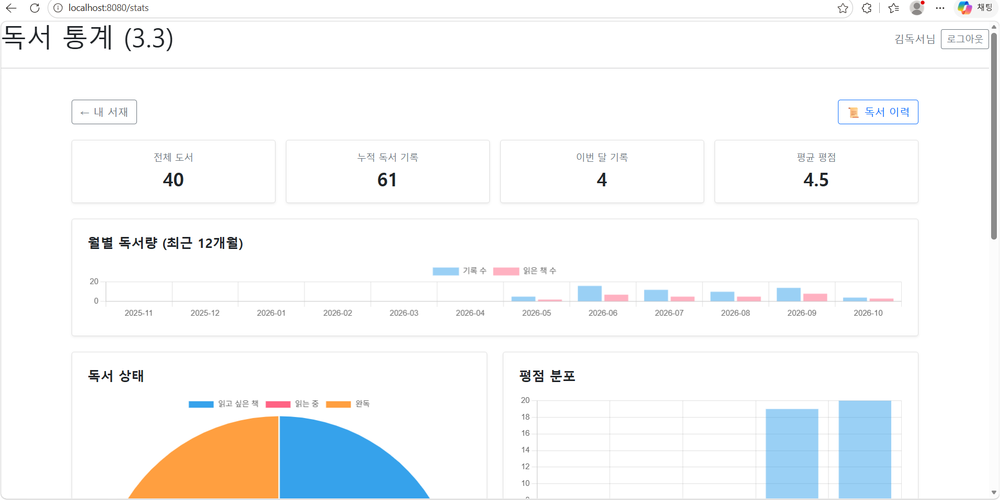
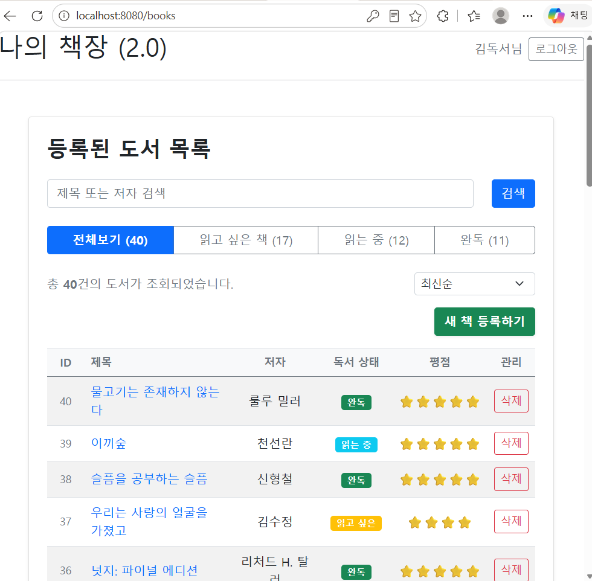
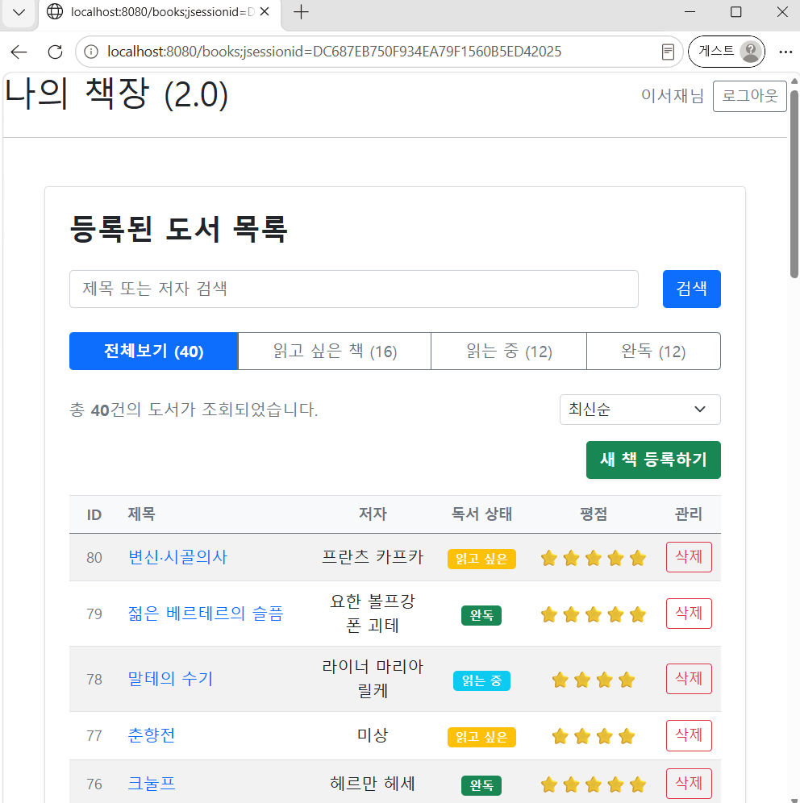
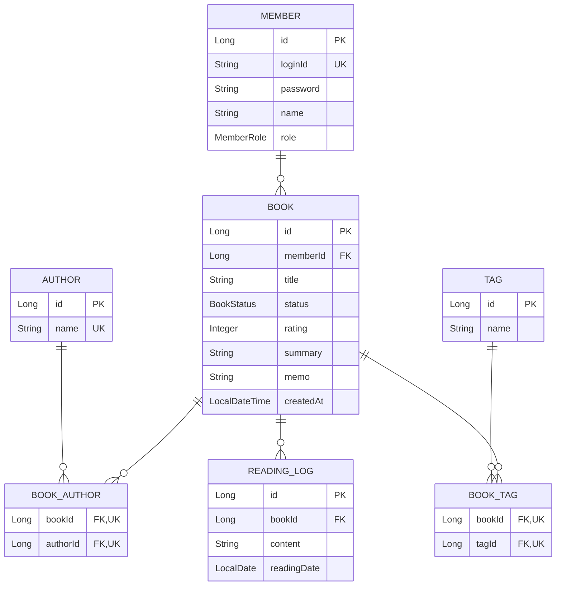

# 📚 BookLog

> **책을 넘어, 읽은 경험과 생각을 기록하는 독서 회고 플랫폼**

---

## 📸 미리보기

| 📊 독서 통계 대시보드 | 📝 도서 상세 · 독서 기록 |
| :---: | :---: |
|  |  |
| *월별 독서량·상태·평점·태그를 DB 집계로 시각화* | *태그와 읽은 날짜별 독서 기록 타임라인* |

**회원별 서재 격리** — 같은 `/books` 주소라도 로그인한 회원에 따라 완전히 다른 서재가 조회됩니다. (세션 인증 + 소유권 검증)

| 👤 user1로 로그인 | 👤 user2로 로그인 |
| :---: | :---: |
|  |  |

더 많은 화면은 아래 마일스톤의 결과 화면 문서에서 확인하실 수 있습니다.

---

## 🎯 프로젝트 소개

BookLog는 사용자가 자신의 독서 기록을 관리하고 책에 대한 생각을 지속적으로 기록할 수 있는 서비스입니다.

단순 CRUD 구현에 그치지 않고, 메모리 기반 애플리케이션으로 시작해
**Spring MVC → 세션 기반 인증 → JPA/MySQL → 관계형 데이터 모델링**
까지 단계적으로 확장하며 학습하고 적용한 성장형 포트폴리오입니다.

---
## ✨ 주요 기능

**👤 회원 및 인증**
- 로그인 / 로그아웃, HTTP Session 기반 인증
- Interceptor를 통한 로그인 사용자 접근 제어
- `@LoginMember` + ArgumentResolver를 이용한 로그인 사용자 주입
- 회원별 자신의 도서 데이터만 조회 / 수정 / 삭제

**📚 도서 관리**
- 도서 등록 / 조회 / 수정 / 삭제, 독서 상태(WISH / READING / DONE) 관리
- 평점 및 독서 메모 관리
- 제목·저자·태그 검색, 다중 정렬, 상태 필터
- 저자·태그 여러 개 등록 가능(N:M)

**✍️ 독서 기록**
- 하나의 도서에 여러 독서 기록을 누적 저장 (`ReadingLog`)
- 읽은 날짜 지정 (월별 독서량 집계 기준)

**📊 독서 통계**
- 월별 독서량·상태·평점·태그 TOP 5
- 개인 독서 이력: 월 필터·페이징

---

## 🔑 핵심 구현 포인트

- **소유권 검증(IDOR 방지)**: 조회·수정·삭제 모두 `memberId` 조건으로 검증하고, 독서 기록 삭제는 조인 조회 한 번으로 "내 책의 기록인지" 확인 → [명세](docs/v3/requirements-v3.1.md)
- **N:M 모델링 + find-or-create**: 저자·태그 입력 문자열을 `BookRelationResolver`가 엔티티로 변환하며 중복 생성을 방지
- **레거시 데이터 마이그레이션**: 엔티티 매핑이 끊긴 컬럼을 `JdbcTemplate`으로 이관하고, 재실행해도 중복되지 않도록 멱등성 가드 적용 → [개발일지](docs/v3/dev-log-v3.md)
- **DB 집계 기반 통계**: `GROUP BY` 집계를 record DTO로 바로 매핑하고, 비어 있는 구간은 서비스에서 0으로 채움 → [명세](docs/v3/requirements-v3.3.md)
- **트러블슈팅 기록**: 버전마다 원인·해결·배운 점을 개발일지에 남김

---

## 🛠️ 기술 스택

**Backend**: Java 21, Spring Boot 4.1.0, Spring MVC, Spring Data JPA, Spring Validation, Hibernate
**Database**: MySQL
**Frontend**: Thymeleaf, HTML / CSS, Chart.js
**Build & Dev**: Gradle, IntelliJ IDEA, Git / GitHub

---

## 🗂️ ERD

---

## 🗺️ 마일스톤 (문서 아카이브)

| 버전 | 주제 | 상태 | 문서 |
| :-- | :-- | :-- | :-- |
| v1.4 | Spring MVC 기반 CRUD | ✅ | [명세](docs/v1/requirements-v1.md) · [일지](docs/v1/dev-log-v1.md) · [화면](docs/v1/screenshots-v1.4.md) |
| v2.0 | 세션 인증 · 사용자별 서재 | ✅ | [명세](docs/v2/requirements-v2.md) · [일지](docs/v2/dev-log-v2.md) · [화면](docs/v2/screenshots-v2.md) |
| v3.0 | JPA/MySQL 전환 · 관계형 모델링 | 기능 완료 · 테스트 복구 중 | [명세](docs/v3/requirements-v3.md) · [일지](docs/v3/dev-log-v3.md) |
| v3.1 | 태그 · 독서 기록 | 기능 완료 · 테스트 복구 중 | [명세](docs/v3/requirements-v3.1.md) · [일지](docs/v3/dev-log-v3.1.md) · [화면](docs/v3/screenshots-v3.1.md) |
| v3.3 | 독서 통계 · 개인 독서 이력 | 기능 완료 · 테스트 복구 중 | [명세](docs/v3/requirements-v3.3.md) · [일지](docs/v3/dev-log-v3.3.md) · [화면](docs/v3/screenshots-v3.3.md) |
| v3.2 | 쿼리 최적화 · 테스트 전환 | ⏳ 예정 | N+1 해결, 연관관계 승격, `@DataJpaTest` |
| v4.0 | 책 공유·교환 플랫폼 | 💭 구상 | — |

