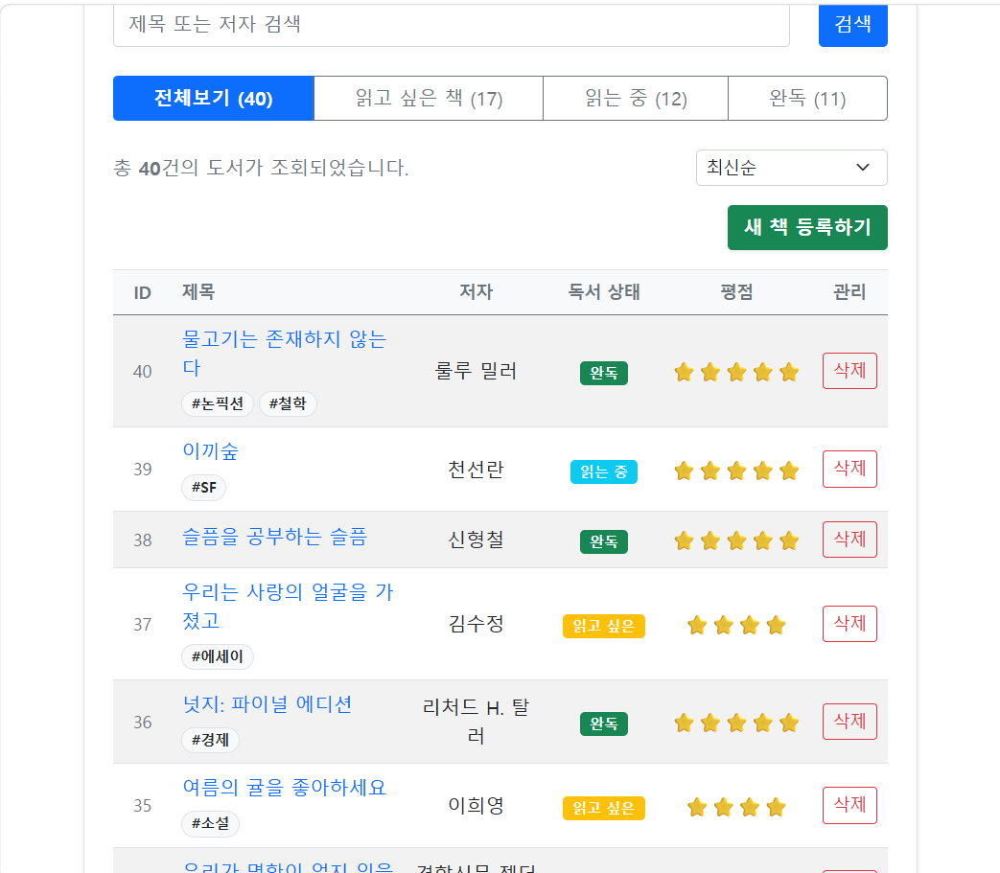
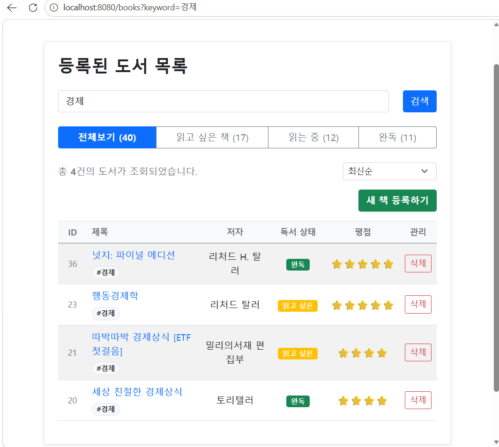
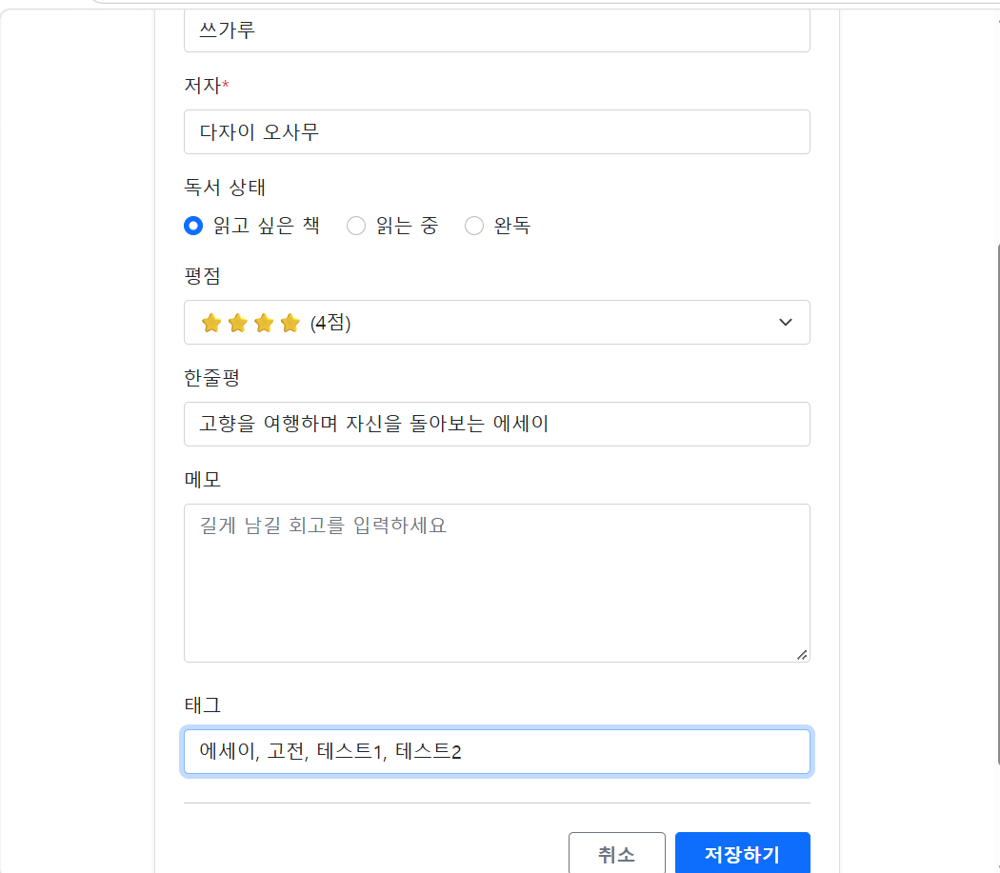
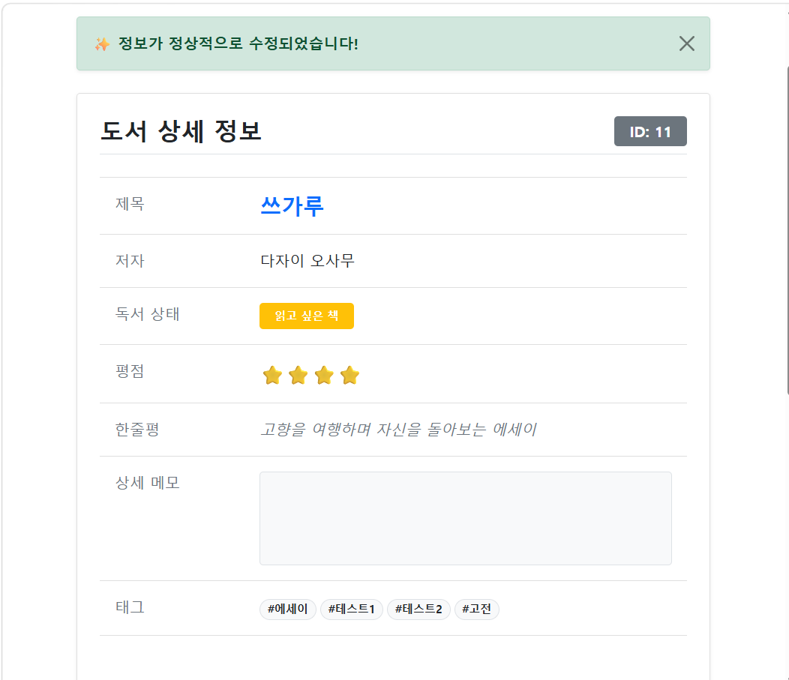
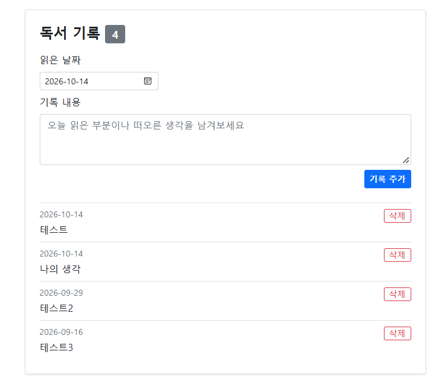
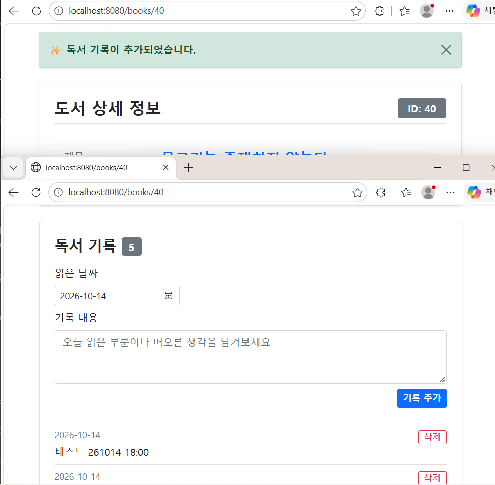
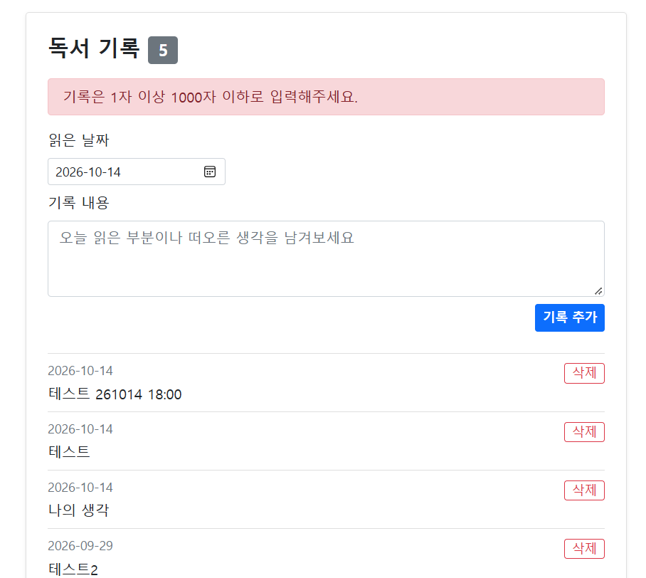
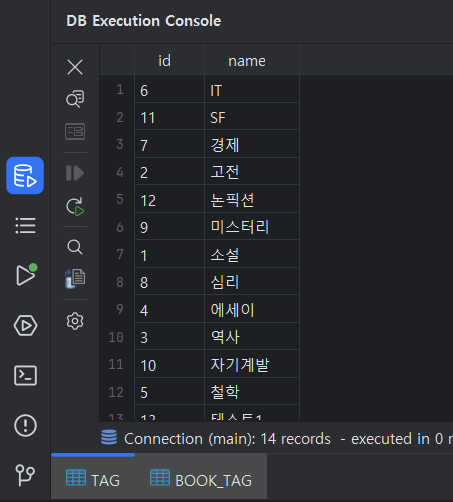
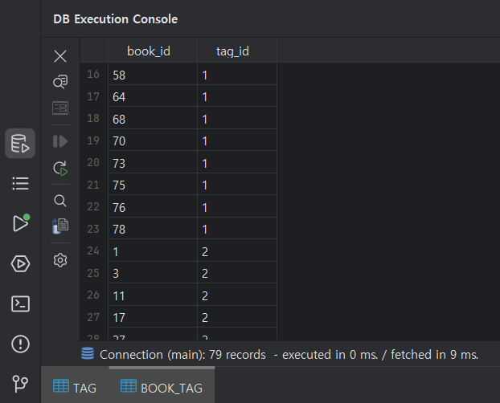

# 🖼️ BookLog v3.1 최종 릴리즈 결과 화면 (Screenshots)

> v3.1 기준 BookLog의 주요 기능 및 UI/UX 결과 화면을 정리합니다.
> v3.0에서 모델링한 Tag·ReadingLog를 화면과 기능으로 연결한 결과를 담고 있으며, 회원별 격리·접근 제어 화면은 [v2.0 결과 화면](../v2/screenshots-v2.md)을 참고하세요.

---

## 🏷️ 1. 태그 — 목록 뱃지 및 태그 검색

* **핵심 기능**: 도서마다 여러 태그를 등록하고, 목록에서 `#태그` 뱃지로 확인.
* **검색 연계**: 뱃지를 클릭하면 해당 태그명으로 키워드 검색이 실행되며, 검색 대상은 제목·저자·태그명.

|                    🏷️ 목록의 태그 뱃지                    |                 🔎 뱃지 클릭 → 태그 검색 결과                  |
|:---------------------------------------------------:|:----------------------------------------------------:|
|  |  |
|           *제목 아래에 `#소설` `#고전` 형태로 표시된 태그*           |             *주소창의 `?keyword=` 값과 필터된 결과*             |

---

## ✏️ 2. 도서 등록/수정 — 태그 입력

* **입력 방식**: 저자·태그 모두 콤마로 구분하여 여러 개 입력.
* **수정 폼**: 기존에 등록된 저자와 태그가 콤마 구분 문자열로 미리 채워짐.

|                  태그를 콤마로 구분하여 입력                   |                       태그가 저장된 결과                       |
|:--------------------------------------------------:|:------------------------------------------------------:|
|  |  |
|             *등록 폼에서는 태그를 콤마로 구분하여 입력*              |                *등록을 하면 개별 태그로 분리되는 모습*                 |

---

## 📝 3. 독서 기록 타임라인

* **핵심 기능**: 하나의 도서에 여러 독서 기록을 읽은 날짜 기준 최신순으로 누적 표시.
* **설계 포인트**: 기록은 회원이 아니라 도서에 직접 연결되며, 날짜는 작성 시각이 아닌 사용자가 지정한 읽은 날짜.

*태그와 독서 기록 타임라인이 함께 표시된 도서 상세 화면*

---

## ➕ 4. 독서 기록 추가 및 검증

* **추가**: 읽은 날짜(기본값 오늘)와 내용을 입력하면 등록 후 상세 화면으로 Redirect(PRG).
* **검증**: 내용이 비어 있거나 1000자를 초과하는 경우, 미래 날짜인 경우 오류 메시지로 안내.

| ✅ 기록 추가 성공 | 🚨 입력 검증 오류 |
| :---: | :---: |
|  |  |
| *등록 직후 성공 메시지와 새 기록이 반영된 화면* | *잘못된 입력에 대한 오류 메시지* |

---

## 🗄️ 5. MySQL 저장 결과

* **핵심 확인**: 저자·태그가 문자열이 아니라 별도 테이블과 조인테이블로 정규화되어 저장되고, 독서 기록이 `book_id`로 도서에 연결됨.

|                         tag                         |                         book_tag                         |
|:---------------------------------------------------:|:--------------------------------------------------------:|
|  |  |

---

## 📌 v3.1 주요 기능 요약

| 기능 | 주요 구현 |
| :--- | :--- |
| 🏷️ 태그 입력 | 콤마 구분 입력 → `BookRelationResolver`로 find-or-create |
| 🔗 태그 검색 | 뱃지 클릭 시 키워드 검색, 검색 대상에 태그명 포함 |
| 📝 독서 기록 | 상세 화면 타임라인, 추가/삭제, PRG 패턴 |
| 📅 읽은 날짜 | 사용자 지정 `LocalDate`, 미래 날짜 차단 |
| 🛡️ 소유권 검증 | 기록 추가/삭제 시 책 소유권 + `logId`↔`bookId` 소속 검증 |
| 🧹 삭제 정리 | 도서 삭제 시 독서 기록 선삭제로 FK 위반 방지 |
| 🌱 더미데이터 | `BookSeed` record, 태그 자동 추론, 기록 시드 분산 |

---

### 🔗 관련 문서 바로가기

* [📝 v3.1 스펙 명세서 보러가기](./requirements-v3.1.md)
* [🗺️ v3.1 개발 일지 보러가기](./dev-log-v3.1.md)
* [🖼️ v2.0 결과 화면 보러가기](../v2/screenshots-v2.md)
* [🏠 메인 README로 돌아가기](../../README.md)