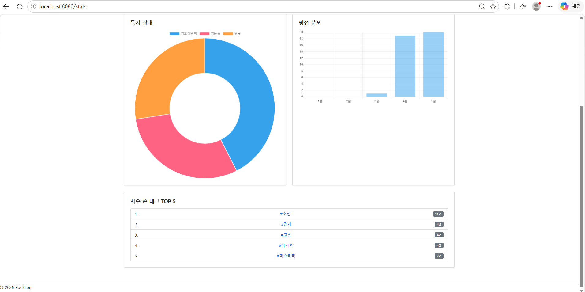
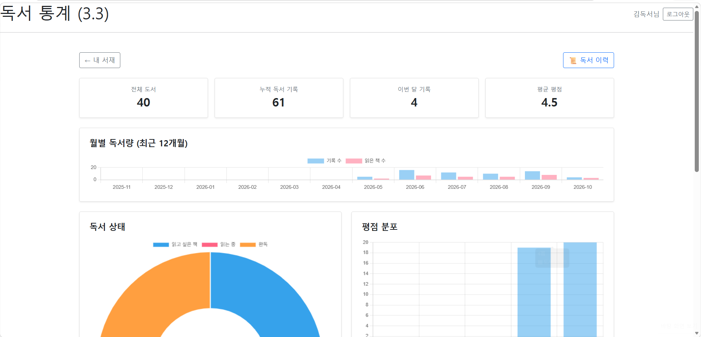
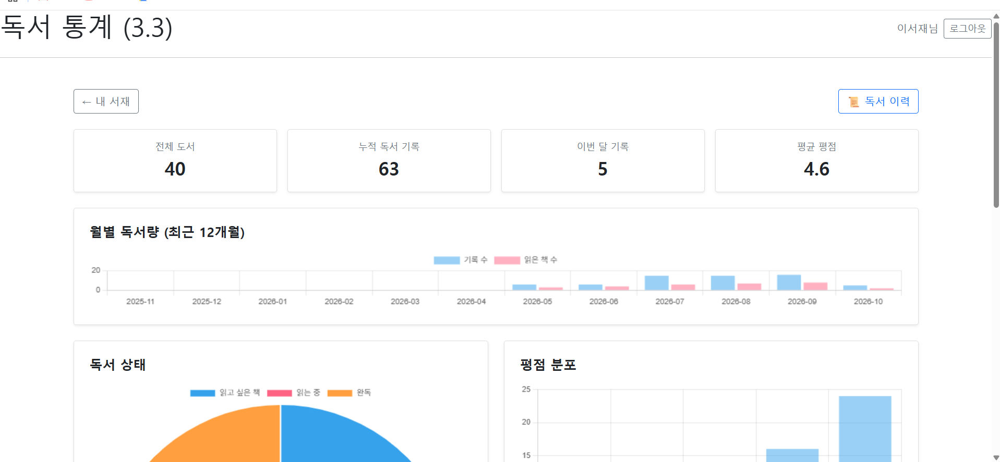
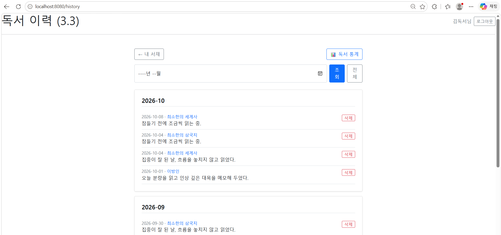
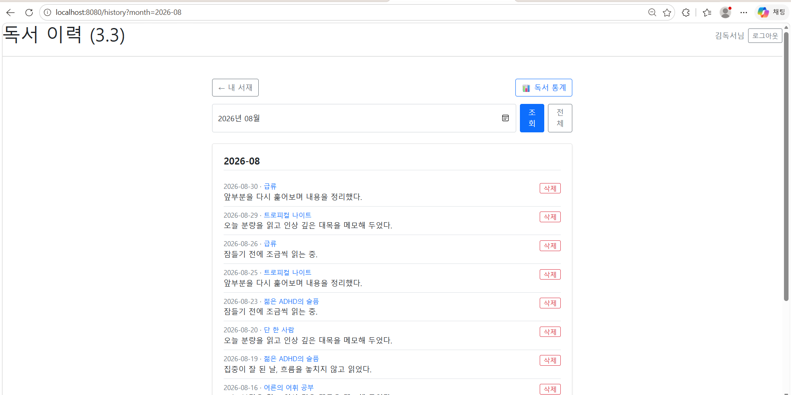

# 🖼️ BookLog v3.3 최종 릴리즈 결과 화면 (Screenshots)

> v3.3 기준 BookLog의 주요 기능 및 UI/UX 결과 화면을 정리합니다.
> v3.1에서 쌓은 독서 기록을 활용한 **독서 통계 대시보드**와 **개인 독서 이력** 화면을 담고 있으며, 태그·독서 기록 화면은 [v3.1 결과 화면](./screenshots-v3.1.md)을 참고하세요.

---

## 📊 1. 독서 통계 대시보드

* **핵심 기능**: 독서 기록을 DB에서 집계해 한 화면에서 독서 현황을 확인.
* **요약 카드**: 전체 도서, 누적 독서 기록, 이번 달 기록, 평균 평점.
* **월별 독서량**: 최근 12개월의 기록 수와 기록이 있는 책 수. 기록이 없는 달도 0으로 표시되어 차트가 끊기지 않음.

*요약 카드와 월별 독서량 차트가 표시된 통계 화면 상단*

### 📈 상태 · 평점 · 태그 통계

* **독서 상태**: 읽고 싶은 책 / 읽는 중 / 완독의 비율.
* **평점 분포**: 1~5점별 도서 수.
* **자주 쓴 태그 TOP 5**: 태그를 클릭하면 해당 태그로 도서를 검색.

*독서 상태, 평점 분포, 태그 TOP 5가 표시된 통계 화면 하단*

---

## 👥 2. 회원별 통계 분리

* **핵심 확인**: 같은 `/stats` 주소라도 로그인한 회원의 데이터만 집계되어 계정마다 통계가 다르게 나타남.

| 👤 user1의 통계 | 👤 user2의 통계 |
| :---: | :---: |
|  |  |
| *user1의 서재 기준으로 집계된 통계* | *user2의 서재 기준으로 집계된 통계* |

---

## 📜 3. 개인 독서 이력

* **핵심 기능**: 책 구분 없이 내 모든 독서 기록을 최신순으로 조회하고 월 단위로 묶어 표시.
* **월 필터**: 원하는 달만 골라 조회하고, 조회 중에도 필터와 페이지가 유지됨.
* **관리**: 각 기록에서 책 상세 화면으로 이동하거나 기록을 삭제.

| 📜 전체 독서 이력 | 🗓️ 월 필터 적용 |
| :---: | :---: |
|  |  |
| *월별로 묶여 표시된 전체 독서 기록* | *주소창의 `?month=`와 함께 특정 월만 조회한 결과* |

---

## 📌 v3.3 주요 기능 요약

| 기능 | 주요 구현 |
| :--- | :--- |
| 📊 월별 독서량 | `readingDate` 기준 `GROUP BY` 집계, 빈 달은 서비스에서 0으로 채움 |
| 🍩 상태·평점 분포 | DB 집계 후 `record` DTO로 매핑, 없는 항목은 0 표시 |
| 🏷️ 태그 TOP 5 | 도서-태그 조인 집계, 클릭 시 키워드 검색 연계 |
| 📜 독서 이력 | 전체 기록 최신순 조회, 월 필터, 10건 페이징 |
| ⚡ 조회 최적화 | 이력 조회 시 `join fetch`로 도서 지연 로딩 방지, `countQuery` 분리 |
| 🛡️ 접근 제어 | 인터셉터 적용 경로에 `/stats/**`, `/history/**` 추가, 삭제 시 소유권 검증 |
| 🌱 더미데이터 | 도서 순번 기반 샘플 기록을 최근 약 5개월에 분산 |

---

### 🔗 관련 문서 바로가기

* [📝 v3.3 스펙 명세서 보러가기](./requirements-v3.3.md)
* [🗺️ v3.3 개발 일지 보러가기](./dev-log-v3.3.md)
* [🖼️ v3.1 결과 화면 보러가기](./screenshots-v3.1.md)
* [🏠 메인 README로 돌아가기](../../README.md)